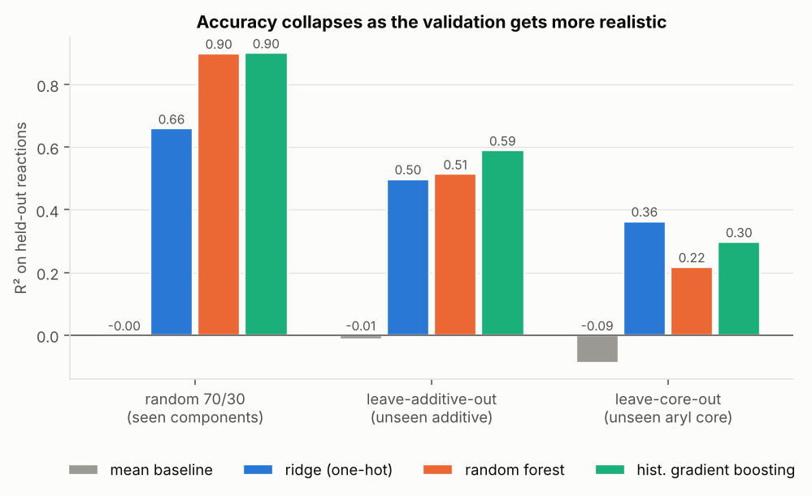
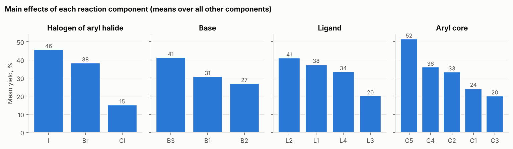
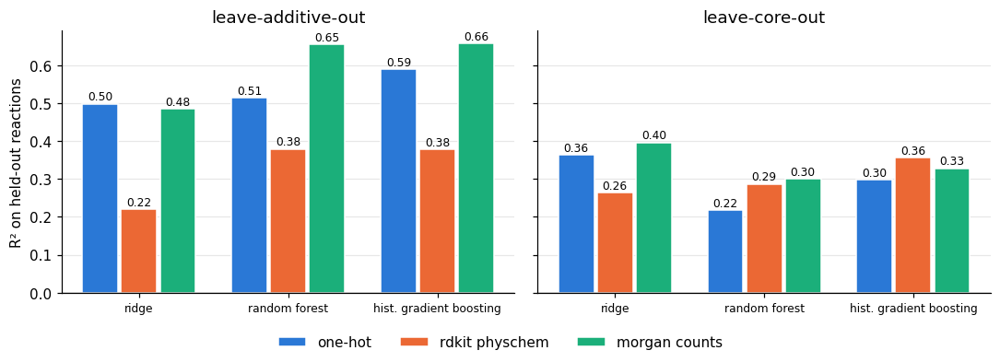
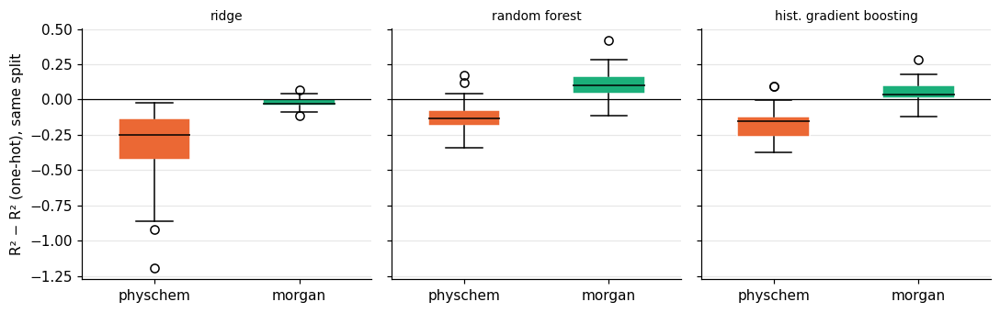
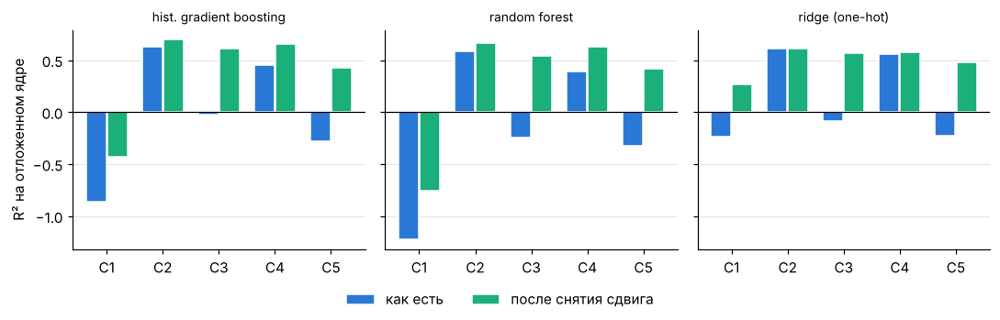

# Предсказание выхода реакции Бухвальда–Хартвига: насколько модель переживает «новую химию»

Учебный проект по хемоинформатике на данных высокопроизводительного скрининга (HTE) реакции C–N кросс-сочетания (Ahneman et al., *Science* 2018). Вопрос: **обобщается ли модель выхода реакции на компоненты, которых не было в обучении, или она только запоминает известные комбинации?**

## Итоги

- **Случайный сплит завышает качество.** Градиентный бустинг даёт R² 0.90 на случайном разбиении 70/30, 0.59 на новой добавке (целиком убрана из обучения) и 0.30 на новом ароматическом ядре.
- **Около 40% потерь на новом ядре — сдвиг среднего уровня выхода.** Для незнакомого ядра модель не знает его среднего выхода (ridge выдаёт среднее по остальным ядрам). После снятия сдвига R² растёт с 0.30 до 0.60.
- **Дескрипторы RDKit помогают умеренно и только на новой добавке.** Счётчики подструктур Morgan дают деревьям в среднем +0.05…+0.10 R² против one-hot (лучше в 24–25 из 30 разбиений) и делают результат стабильнее; простые физико-химические дескрипторы хуже one-hot. На новом ядре наборы признаков различить нельзя.
- **На что опирается модель:** галоген, ароматическое ядро и добавка важнее лиганда и основания.

Подробности, таблицы и ограничения ниже.

### Главный результат: три схемы валидации



| Схема валидации | Mean baseline | Ridge (one-hot) | Random forest | Hist. grad. boosting |
|---|---|---|---|---|
| Случайный 70/30 (10 повторов) | −0.00 | 0.66 | 0.90 | **0.90** |
| Новая добавка (leave-one-additive-out, 22 фолда) | −0.01 | 0.50 | 0.51 | **0.59** |
| Новое ядро (leave-one-core-out, 5 фолдов) | −0.09 | **0.36** | 0.22 | 0.30 |

R² на отложенных реакциях; для групповых схем предсказания всех фолдов объединены перед подсчётом. RMSE и MAE в `reports/metrics.csv`. На новом ядре простая линейная модель лучше леса; почему, разобрано в разделе «Откуда потери на новом ядре».

## Данные

3955 реакций: 4 лиганда × 22 добавки × 3 основания × 15 арилгалогенидов (5 ароматических ядер × Cl/Br/I), в таблице нет пропусков и дублей комбинаций. Компоненты заданы SMILES, выход в процентах (медиана 29%, нулевой выход у 6% реакций, ≥70% у 13%). Таблица взята из [rxn4chemistry/rxn_yields](https://github.com/rxn4chemistry/rxn_yields) (MIT); оригинальные данные: Ahneman et al., *Science* 360, 186 (2018). Файл в репозиторий не включён, его скачивает `src/download_data.py`.

Идентификаторы `L1…`, `B1…`, `A1…`, `C1…` присвоены по алфавитному порядку SMILES, соответствие SMILES ↔ id лежит в `data/processed/reactions.csv` после запуска.

Все листы исходной книги содержат одни и те же 3955 реакций в разном порядке. Листы `Test1–4` **не использованы**: часть добавок из их тестовых частей встречается и в обучающих (например, 3 из 9), так что это не чистая проверка на новые добавки. Вместо них строгие групповые сплиты сделаны самостоятельно.

## Что видно в данных



Средний выход сильно зависит от галогена (I 46%, Br 38%, Cl 15%), ароматического ядра (от 20% до 52%) и добавки (от 9% до 47%, см. `reports/figures/03_additive_effects.png`).

**Групповая permutation importance** (перемешивание компонента целиком в тесте, падение R² градиентного бустинга; среднее по 5 сплитам × 20 перемешиваний):

| Компонент | Падение R² |
|---|---|
| галоген | 0.67 |
| ароматическое ядро | 0.56 |
| добавка | 0.49 |
| лиганд | 0.33 |
| основание | 0.30 |

Это описание того, на что опирается модель, а не причинные эффекты.

## Дескрипторы вместо one-hot

Проверка идеи, что описание молекул числами поможет на новых компонентах. Код: `src/descriptors.py`, `src/evaluate_descriptors.py`. Добавка и ароматическое ядро кодируются дескрипторами RDKit, лиганд, основание и галоген остаются one-hot, схемы валидации те же. Два набора признаков:

- **rdkit physchem**: молекулярная масса, logP, TPSA, доноры и акцепторы H-связей, вращаемые связи, кольца, доля sp³-углерода, число тяжёлых атомов и счётчики атомов по элементам;
- **morgan counts**: счётчики подструктур (отпечаток Моргана, радиус 2, 128 бит).

Ridge масштабирует дескрипторы внутри каждого фолда обучения, чтобы тестовая молекула не влияла на масштаб. Запуск: `pip install -r requirements-rdkit.txt`, затем `python -I src/evaluate_descriptors.py` или раздел 5 ноутбука; результаты пишутся в `reports/metrics_descriptors.csv`.



R² на отложенных реакциях (одинаковые схемы валидации, три набора признаков):

| Схема | Признаки | Ridge | Random forest | Hist. grad. boosting |
|---|---|---|---|---|
| Новая добавка | one-hot | 0.498 | 0.514 | 0.590 |
| | rdkit physchem | 0.221 | 0.379 | 0.378 |
| | morgan counts | 0.485 | 0.654 | **0.658** |
| Новое ядро | one-hot | 0.364 | 0.218 | 0.298 |
| | rdkit physchem | 0.264 | 0.287 | 0.356 |
| | morgan counts | **0.396** | 0.300 | 0.328 |
| Случайный 70/30 | one-hot | 0.659 | 0.899 | **0.901** |
| | rdkit physchem | 0.556 | 0.529 | 0.741 |
| | morgan counts | 0.629 | 0.729 | 0.809 |

- Счётчики подструктур Morgan немного помогают на **новой добавке**: лучший R² вырос с 0.59 до 0.66, у случайного леса с 0.51 до 0.65. Простые физико-химические дескрипторы ухудшили результат (лучший 0.38).
- На **новом ядре** выигрыша не видно: лучший one-hot 0.36, лучший с дескрипторами 0.40. При 5 фолдах такую разницу от шума не отличить.
- Цена дескрипторов: на **случайном сплите** они хуже one-hot (лучший R² 0.81 у Morgan и 0.74 у физико-химических против 0.90), потому что one-hot прямо кодирует идентичность компонента.
- Это один запуск без доверительных интервалов, а «лучший результат» выбран по тем же тестовым фолдам, что и оценка; прирост 0.07 на новой добавке заметен, но не доказан (проверка на многих разбиениях ниже).

### Устойчивость к выбору разбиений

`src/robustness.py` (раздел 6 ноутбука) повторяет сравнение на 30 случайных наборах, где каждый раз 6 из 22 добавок целиком уходят в тест, и для каждого разбиения считает разность R² с one-hot на том же разбиении. Для ядер R² считается отдельно по каждому из 5 отложенных ядер. Разбиения пересекаются, поэтому разброс показывает зависимость результата от выбора добавок, а не доверительный интервал. Запуск: `python -I src/robustness.py` (5–10 минут, нужен RDKit; в `run_all.sh` включается через `RUN_ROBUSTNESS=1`).



Новая добавка, 30 разбиений: разность R² с one-hot на тех же разбиениях.

| Признаки | Модель | Средняя разность | Лучше one-hot в |
|---|---|---|---|
| morgan counts | hist. grad. boosting | +0.045 | 24 из 30 |
| | random forest | +0.102 | 25 из 30 |
| | ridge | −0.021 | 8 из 30 |
| rdkit physchem | hist. grad. boosting | −0.173 | 2 из 30 |
| | random forest | −0.126 | 4 из 30 |
| | ridge | −0.329 | 0 из 30 |

- Выигрыш Morgan у деревьев на новой добавке сохраняется, но он скромнее, чем показывал единичный прогон: в среднем +0.05 у бустинга (в разделе выше было +0.07) и +0.10 у леса. У ridge выигрыша нет.
- Morgan делает результат стабильнее: разброс R² по разбиениям меньше (std 0.095 против 0.140 у бустинга, 0.105 против 0.159 у леса), а худшее разбиение лучше (0.389 против 0.105 у бустинга, 0.405 против −0.017 у леса).
- Физико-химические дескрипторы на новой добавке стабильно хуже one-hot.
- На **новом ядре** наборы признаков различить нельзя: R² сильно зависит от того, какое из 5 ядер отложено (C2 предсказывается лучше всех, C1 хуже всех у one-hot и Morgan), а разброс разностей по ядрам больше их средних. Кажущийся выигрыш физико-химических дескрипторов у деревьев (+0.23 и +0.27) почти целиком даёт одно ядро C1; без него разность близка к нулю.
- Разбиения пересекаются, поэтому доли побед завышают уверенность, а это разброс по разбиениям, не доверительный интервал.

## Откуда потери на новом ядре: сдвиг уровня выхода

Гипотеза: для ядра, которого модель не видела, ей не известен средний выход этого ядра, а R² на отложенном ядре штрафует именно за этот сдвиг. Проверка (`src/offset_analysis.py`, раздел 7 ноутбука): ошибка на каждой отложенной группе раскладывается на смещение среднего и остальное (MSE = смещение² + дисперсия ошибки), а R² пересчитывается после вычитания смещения из прогнозов. Вычитание использует истинное среднее отложенной группы, поэтому это диагностика, а не рабочая модель.



Объединённый R² как есть и после снятия сдвига (one-hot модели):

| Схема | Модель | R² | R² без сдвига | Возвращено от потерянного |
|---|---|---|---|---|
| Новое ядро | hist. grad. boosting | 0.298 | 0.599 | 43% |
| | random forest | 0.218 | 0.557 | 43% |
| | ridge | 0.364 | 0.612 | 39% |
| Новая добавка | hist. grad. boosting | 0.590 | 0.763 | 42% |
| | random forest | 0.514 | 0.694 | 37% |
| | ridge | 0.498 | 0.659 | 32% |

- **Механизм виден напрямую у ridge:** на незнакомом ядре он выдаёт средний выход остальных ядер (разница со средним по обучению не больше 0.1 на всех пяти ядрах). Поэтому ядра с низким выходом он завышает (C3 на +16, C1 на +10), а ядро с самым высоким выходом занижает (C5 на −23). Деревья на C1, C3 и C5 делают то же самое, но на C2 и C4 занижают уровень ещё на 7–11 пунктов.
- **Остальные потери — ошибки внутри ядра.** Порядок реакций внутри ядра предсказывается неплохо (корреляция Спирмена 0.64–0.90), но масштаб разброса неверный: на C2, C4 и C5 прогнозы «сжаты» (0.55–0.73 от истинного стандартного отклонения), на C1 «раздуты» (1.4 у ridge, 1.9–2.1 у деревьев). Поэтому у деревьев C1 остаётся отрицательным даже после снятия сдвига.
- **Это объясняет, почему ridge лучше леса на новом ядре (0.36 против 0.22):** преимущество почти целиком создают C1 (R² −0.24 против −1.22: деревья сильнее раздувают разброс) и C4 (0.56 против 0.39–0.46: деревья занижают уровень на 10–11 пунктов относительно среднего по обучению).
- Диагностика сделана на 5 ядрах и одном датасете; почему именно на C2 и C4 деревья занижают уровень, не исследовано.

## Ограничения

- **One-hot не умеет обобщать.** Новая категория превращается в строку нулей, и модель может опираться только на остальные компоненты. Групповые сплиты это и измеряют. Попытка исправить это дескрипторами RDKit описана в разделе «Дескрипторы вместо one-hot» выше.
- **Мало уровней.** 4 лиганда, 3 основания, 5 ядер. В схеме leave-core-out всего 5 фолдов, оценка шумная; R² для неё объединённый, без доверительных интервалов.
- **Один набор условий.** Полный факториальный эксперимент одной лаборатории, а не литературные данные: нет публикационного смещения, но и перенос на другие реакции не проверен.
- **Без подбора гиперпараметров.** Используются значения по умолчанию scikit-learn, поэтому различия между лесом и бустингом (особенно 0.51 против 0.59) не стоит трактовать как окончательные.
- **Отрицательный R² у baseline** в групповых схемах возникает, потому что средний выход отложенной группы отличается от среднего по трейну.
- **Разбор сдвига уровня** сделан только для one-hot моделей: предсказания моделей с дескрипторами не сохранялись.

## Воспроизведение

```bash
git clone https://github.com/etl-and-pray/bh-yield-prediction.git
cd bh-yield-prediction
pip install -r requirements.txt
./run_all.sh        # скачивание данных, метрики, сдвиг уровня выхода, важность признаков, графики
pip install -r requirements-rdkit.txt   # по желанию: эксперимент с дескрипторами
```

Если RDKit установлен, `run_all.sh` дополнительно запускает эксперимент с дескрипторами; без него этот шаг пропускается.

Тесты (не требуют сети и RDKit): `pip install -r requirements-dev.txt && pytest`.

Ноутбук `notebooks/analysis.ipynb` проходит анализ по шагам (данные, EDA, три схемы валидации, важность компонентов, дескрипторы, устойчивость, сдвиг уровня выхода); он вызывает код из `src/`. Структура: `src/data.py` (загрузка и проверки), `src/evaluate.py` (три схемы валидации), `src/importance.py`, `src/figures.py`, `src/descriptors.py` и `src/evaluate_descriptors.py` (дескрипторы RDKit), `src/robustness.py` (устойчивость сравнения), `src/offset_analysis.py` (сдвиг уровня выхода); тесты в `tests/`, результаты в `reports/`. Сиды зафиксированы; повторный запуск с нуля даёт идентичные метрики.

## Идеи для развития

1. Подбор гиперпараметров во вложенной групповой валидации: сейчас везде значения по умолчанию.
2. Датасет Suzuki–Miyaura из того же репозитория как проверка того, что вывод не специфичен для одной реакции.
3. Разбор сдвига уровня для моделей с дескрипторами (для этого нужно сохранять их предсказания).
4. SHAP вместо permutation importance.
5. Квантово-химические дескрипторы (как в оригинальной статье) вместо простых физико-химических.

## Лицензия и источники

Код распространяется под лицензией MIT (файл `LICENSE`). Данные в репозиторий не включены: их скачивает `src/download_data.py` из [rxn4chemistry/rxn_yields](https://github.com/rxn4chemistry/rxn_yields). Исходная работа: Ahneman, D. T. et al. *Predicting reaction performance in C–N cross-coupling using machine learning.* Science 360, 186–190 (2018).

Автор: [etl-and-pray](https://github.com/etl-and-pray).
